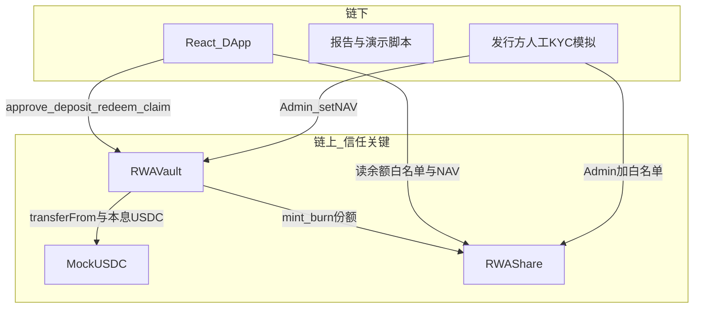
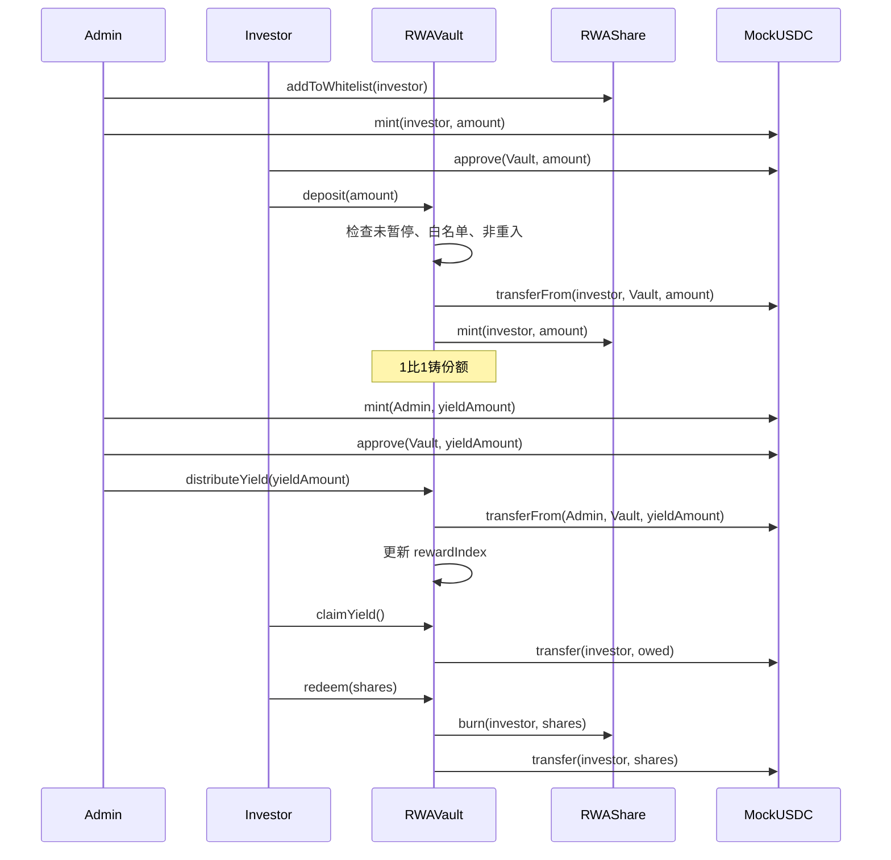
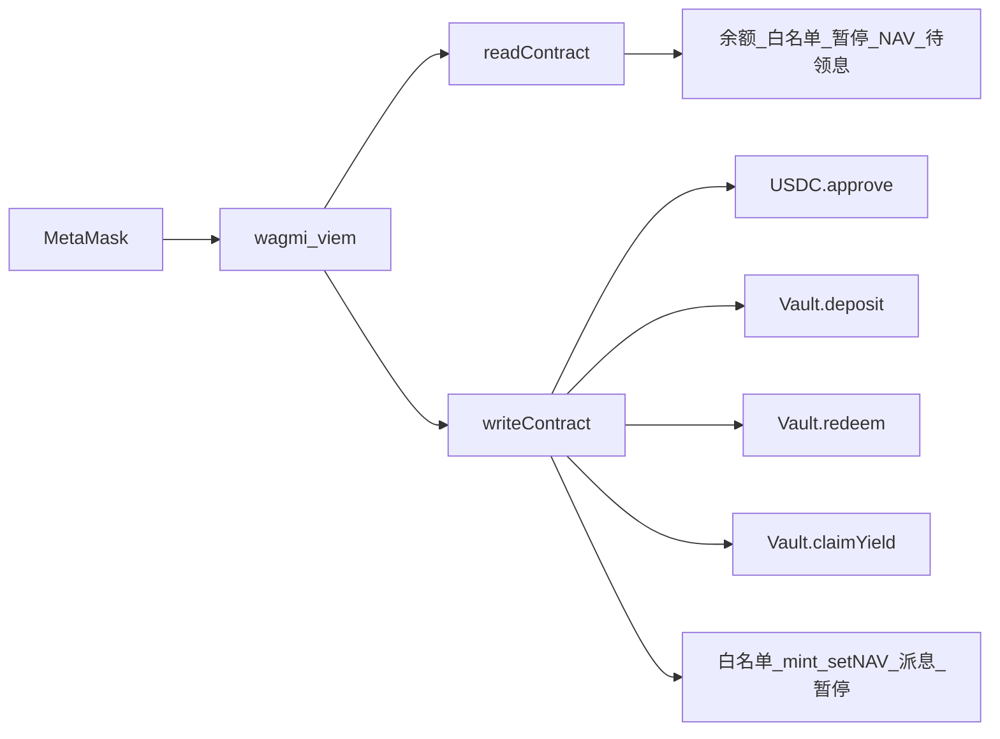

# RWA 许可份额金库 · 技术设计文档

> 版本：v1.1（标准版 MVP+；Admin `setNAV` 升为必做）  
> 定位：课程 / 小组作业级教学演示（非真实证券产品）  
> 配套学习日志：[project-log/](../project-log/README.md)  
> 配套分工：[小组分工.md](./小组分工.md)

本文是整项目的**总设计说明**：问题与原理、架构、总数据流、合约逻辑、前端调用、安全与部署边界。实现细节可再对照各阶段 `project-log/*/log.md`。

---

## 1. 问题陈述与项目定位（R1）

### 1.1 一句话

做一个以太坊上的 **RWA（真实世界资产）许可份额认购演示**：管理员用白名单模拟合规准入；投资者用测试稳定币申购份额、可赎回，并按份额领取收益；未在名单中的地址无法持有或接收份额。

### 1.2 目标用户与痛点

| 角色 | 诉求 | 传统做法的问题 |
|------|------|----------------|
| 发行方 / 管理员 | 只有合格投资者能持有份额 | 名单在 Excel/中心库，与打款流程脱节，可被私下改规则 |
| 合规投资者 | 交稳定币后明确拿到份额，规则可验证 | 准入与交割不同步；账本不透明 |

### 1.3 为何用智能合约而不是传统数据库

1. **可编程合规**：转让限制写进代币逻辑，前端藏按钮挡不住，链上 `transfer` 会直接失败。  
2. **原子结算**：同一笔交易内完成「扣 USDC + 铸份额」或「毁份额 + 退 USDC」，避免半成功脏数据。  
3. **规则透明**：白名单变更、申购赎回、派息均有事件，可审计。  
4. **按份额执行收益**：利息按持仓比例由合约计算领取，减少单方改账。

### 1.4 模拟假设与范围

**链下口头假设（本项目不开发）：** 存在一笔被托管的短期债券 / 应收账款。  

**链上真正实现：** 份额代币 = 数字凭证；白名单 = 模拟已 KYC；Vault = 稳定币与份额的柜台。

| 纳入标准版（必做） | 不纳入（报告写死） |
|--------------------|--------|
| 多项目目录、白名单、申购、赎回、暂停、简易派息 | 真实 KYC / 证件存储 |
| **每项目 Admin `setNAV`（中心化净值喂价）** | Chainlink 等外部/去中心化预言机 |
| MockUSDC、测试网 Sepolia | 主网、真美元、真证券发行 |
| 事件、权限、单测、Slither、Echidna | 二级订单簿、跨项目合并金库 |
| 市场 / 项目详情 / Admin 前端 | 完整 ERC-3643、多资产池、IPFS |

**诚实边界：** 白名单 ≠ 真 KYC；MockUSDC ≠ 真美元；**`setNAV` ≠ 去中心化预言机**；**下架 ≠ 暂停**。净值为项目方链上提交的价格，信任假设落在持有 NAV 角色私钥的人；本项目**刻意不接** Chainlink。完整规则表见 [下架与暂停对照.md](./下架与暂停对照.md)。

> 净值细节见 **§6.6 Admin `setNAV`（必做）**。在 Vault 申购/赎回主路径中实现，不可降级为「只写报告不做代码」。

---

## 2. 技术栈

| 层 | 选型 |
|----|------|
| 合约 | Solidity 0.8.24、OpenZeppelin 5.x（ERC20、AccessControl、Pausable、ReentrancyGuard、SafeERC20） |
| 工具链 | Hardhat + hardhat-toolbox |
| 前端 | React、Vite、wagmi、viem、react-router、MetaMask |
| 网络 | Hardhat 本地（31337）/ Sepolia |
| 安全 | Hardhat 单测、Slither、Echidna |

---

## 3. 系统架构与链上 / 链下划分（R2）

### 3.1 总架构



### 3.2 划分原则

| 放链上（信任关键） | 放链下 |
|--------------------|--------|
| 代币余额、白名单、暂停开关、**当前 NAV** | UI、文案、演示讲稿 |
| 申购 / 赎回 / 派息会计状态 | 「点按钮表示 KYC 通过」（调 Admin 交易） |
| 角色权限、事件日志 | 链下估值假设、报告、截图 |

**不做：** 链下文件存储 / IPFS；**不做** Chainlink 等外部预言机（用 Admin `setNAV` 代替）。

### 3.3 三个核心合约

| 合约 | 职责 | 关键能力 |
|------|------|----------|
| `MockUSDC` | 测试稳定币（6 decimals） | 仅 Admin `mint` |
| `RWAShare` | 许可型份额 ERC-20 | 白名单拦截转让；仅 Vault mint/burn |
| `RWAVault` | 金库柜台 | `deposit` / `redeem` / **`setNAV`** / 读 `nav` / `distributeYield` / `claimYield` / `pause` |

**净值计价（标准版必做）：** Vault 存 `nav`（6 位小数缩放，`1e6` = 1 份额兑 1 USDC）。申购/赎回按当前 `nav` 换算（§6.6）。部署初始 `nav = 1e6`；演示中 Admin 可改价。**仍不接** Chainlink。

---

## 4. 角色

| 链上角色 | 谁 | 能做什么 |
|----------|-----|----------|
| 平台 · Registry Owner | `ProjectRegistry` 所有者 | 登记项目、上架 / 下架（`setListed`；**目录开关，≠ pause**） |
| 项目方 · Share/Vault Admin | 该项目 `DEFAULT_ADMIN_ROLE` | 投资者准入、**setNAV**、分配收益、暂停 / 恢复柜台 |
| Minter / Burner | **仅该项目 `RWAVault` 合约地址** | 铸/毁对应 `RWAShare` |
| 投资人 | 已在该项目白名单的外部账户 | approve、认购、赎回、领收益 |

投资者**不能**自己 mint 份额，否则等于私自印「债券本」。  
**强制对照（下架 vs 暂停、setNAV 边界、范围外）** 见 [下架与暂停对照.md](./下架与暂停对照.md)；演示建议用不同钱包拆开平台 / 项目方 / 投资人。

---

## 5. 总数据流（端到端）

### 5.1 主路径一览（人话）

```text
管理员加白名单 + 发测试 USDC
        ↓
（必做演示）管理员 setNAV（可先保持 1e6，再改为其他净值）
        ↓
投资者 approve → deposit（按当前 nav 扣 USDC、铸份额）
        ↓
（可选降级）管理员注入利息 → 投资者 claimYield
        ↓
投资者 redeem（按当前 nav 毁份额、退 USDC）
        ↓
全程：未白名单地址无法接收份额；暂停后柜台关闭
```

### 5.2 完整时序图



### 5.3 状态机视角（链上改了什么）

整系统可看成改以下几类状态：

| 状态 | 谁改 | 典型交易 |
|------|------|----------|
| `whitelist[addr]` | Admin | `addToWhitelist` / `remove` |
| `USDC.balanceOf` | mint / transferFrom / transfer | 发测试币、申购、派息、赎回、领息 |
| `Share.balanceOf` / `totalSupply` | Vault mint/burn；用户 transfer | 申购、赎回、白名单间转让 |
| `nav` | Admin | `setNAV`（必做） |
| `paused` | Admin | `pause` / `unpause` |
| `rewardIndex` / `userIndex` / `claimable` | Vault | 注入利息、accrue、claim |

前端只是触发这些状态变更的按钮层；**权限与守恒必须在合约内成立**。

### 5.4 分场景数据流

#### A. 加白名单（准入）

```text
Admin 钱包
  → Share.addToWhitelist(investor)
  → whitelist[investor] = true
  → emit WhitelistUpdated
```

#### B. 申购（原子结算）

```text
Investor
  → USDC.approve(Vault, assets)          // 授权金库扣款
  → Vault.deposit(assets)
       → transferFrom(Investor → Vault) // 扣稳定币
       → shares = assets * 1e6 / nav       // 按净值铸份额（nav=1e6 时即 1:1）
       → Share.mint(Investor, shares)
       → emit Deposited
```

任一步失败则整笔交易回滚（原子性）。

#### C. 非法持有（合规拦截）

```text
Investor（在名单）→ Share.transfer(陌生人, x)
  → _update 检查：陌生人 not whitelist
  → revert
```

#### D. 派息（pull，无全体 for 循环转账）

```text
Admin → Vault.distributeYield(amount)
  → USDC 转入 Vault
  → rewardIndex += amount * 1e18 / totalSupply

Investor → Vault.claimYield()
  → _accrue(Investor)
  → USDC.transfer(Investor, owed)
```

#### E. 赎回

```text
Investor → Vault.redeem(shares)
  → _accrue（若已实现派息）
  → assetsOut = shares * nav / 1e6
  → Share.burn(Investor, shares)
  → USDC.transfer(Investor, assetsOut)
  → emit Redeemed
```

#### F. 暂停

```text
Admin → Vault.pause()
  → deposit / redeem / setNAV（建议）/ distribute / claim 均 whenNotPaused 失败
```

#### G. 设置净值（必做）

```text
Admin → Vault.setNAV(newNav)
  → 校验 newNav > 0（及项目约定上下界，若有）
  → nav = newNav
  → emit NavUpdated
```

演示注意：上调 NAV 会使同一份额兑出更多 USDC，金库须有足够余额；可先向 Vault 注入额外 MockUSDC，或先演示下调再赎回。

---

## 6. 合约原理详解

### 6.1 MockUSDC

- ERC-20，`decimals = 6`（贴近真实 USDC）。  
- `mint(to, amount)` 仅 Admin，便于演示发测试币。  
- 无转让限制（稳定币本身可自由转；**受限的是份额**）。

### 6.2 RWAShare（许可代币）

- ERC-20 + `AccessControl`。  
- `mapping(address => bool) whitelist`；增删仅 Admin，并 `emit WhitelistUpdated`。  
- 建议提供 `addToWhitelistBatch(address[] calldata accounts)`，符合作业「只读参数优先 calldata」、且循环长度由调用方控制。  
- 重写 `_update(from, to, value)`：  
  - 用户互转（`from != 0 && to != 0`）：双方均须在白名单；  
  - 铸造（`from == 0`）：`to` 须在白名单；  
  - 销毁（`to == 0`）：`from` 须在白名单。  
- `mint` / `burn` 仅 `MINTER_ROLE` / `BURNER_ROLE`（授予 Vault）。  
- 份额在用户间转让前，若已实现派息，应通知 Vault 对 `from`/`to` 做 `_accrue`，避免利息错领。

> 思路对齐许可资产（如 ERC-3643），实现为教学简化版，**不声称完整实现标准**。

### 6.3 RWAVault（金库）

| 函数 | 行为要点 |
|------|----------|
| `deposit(assets)` | `whenNotPaused` + `nonReentrant`；调用者在白名单；`SafeERC20.transferFrom`；按 `shares = assets * 1e6 / nav` 铸造 |
| `redeem(shares)` | 对称：先结息（若有）→ `burn` → 退 `assetsOut = shares * nav / 1e6` |
| `setNAV(newNav)` | **必做**；仅 Admin；见 §6.6 |
| `pause` / `unpause` | 仅 Admin |
| `distributeYield` | 仅 Admin；`totalSupply > 0`；更新指数 |
| `claimYield` | 用户拉取已累计利息 |

**安全写法：** Checks-Effects-Interactions（先改会计/burn，再转代币）+ `ReentrancyGuard`。

**升级策略（R5）：** 不使用 Proxy；合约不可升级。应急用 `pause`；修复则新部署并说明迁移。报告中写明：教学场景降低代理复杂度与攻击面；Admin 密钥仍是中心化信任点（含 **NAV 喂价**）。

### 6.4 派息：reward index 原理

禁止 `for` 遍历所有投资者转账（Gas 无界、易超块限制）。采用 **累计分红指数（pull）**：

```text
注入利息 amount 时：
  rewardIndex += amount * 1e18 / share.totalSupply()

用户结算时：
  delta = rewardIndex - userIndex[user]
  owed  = balanceOf(user) * delta / 1e18
  userIndex[user] = rewardIndex
```

`1e18` 用于放大，减轻 Solidity 整数除法精度损失；允许极小舍入尘埃留在金库，报告中可如实说明。

**份额变动前必须 accrue：** 否则卖方可能丢息、买方捡息。挂钩点：`deposit` / `redeem` / `claimYield`，以及 `RWAShare` 用户互转时回调 `IVault.accrue`。

### 6.5 资金守恒（测试 / Echidna 用）

- **无派息且 nav 恒为 `1e6`：** `USDC.balanceOf(Vault) == Share.totalSupply()`。  
- **无派息、nav 可变：** 偿付相关不变量宜写成  
  `USDC.balanceOf(Vault) >= Share.totalSupply() * nav / 1e6`（整数除法有尘埃时用 `>=`）；改 NAV 后若不等式不成立，须先注资或限制 `setNAV`。  
- **有派息时：** `USDC.balanceOf(Vault) >= 按 nav 计价的本金索取 + 未领利息会计合计`。  
- **准入：** 非白名单地址 `Share.balanceOf == 0`（`removeFromWhitelist` 要求余额为 0，禁止「有仓踢出」）。

### 6.6 Admin `setNAV`（必做 · 作业演示级净值）

**定位：** 用管理员链上喂价模拟「真实世界资产净值」，**代替** Chainlink 等外部预言机。属标准版必做，不是可选项。

**状态与缩放：**

- 状态变量：`uint256 public nav`  
- 约定：`nav` 与 MockUSDC 同为 **6 位小数缩放**；`nav == 1e6` 表示 1 份额 = 1 USDC  
- 构造 / 部署：初始 `nav = 1e6`

**接口：**

```text
function setNAV(uint256 newNav) external onlyRole(DEFAULT_ADMIN_ROLE);
event NavUpdated(uint256 oldNav, uint256 newNav);
```

建议校验：`newNav > 0`；可选上下界（如禁止极端操纵），报告说明取值策略。

**换算（与 §6.3 一致）：**

```text
deposit(assets):  shares    = assets * 1e6 / nav
redeem(shares):   assetsOut = shares * nav / 1e6
```

**与派息的关系：** `setNAV` 改的是本金兑换价；`distributeYield` / `claimYield` 是另账利息。二者不要混成「改 NAV 就自动发息」。报告写清双轨，避免双重计算。

**信任与威胁：** Admin 可抬高/压低净值影响申购赎回，属**中心化喂价操纵**风险。缓解：报告披露；单测覆盖非 Admin 不能 `setNAV`；演示脚本不依赖外部预言机。作业明确：**不接 Chainlink**。

**验收：** 有 `setNAV` 代码与测试；前端 Admin 可改净值、Invest/Home 能读并展示当前 `nav` 与预估份额/赎回额。

---

## 7. 前端数据流

### 7.1 调用链



- **读**：一般不弹窗、不耗 Gas（含读 `nav`）。  
- **写**：必须签名；申购通常两笔——先 `approve`，再 `deposit`。  
- 前端隐藏 Admin 按钮 **不等于** 安全；鉴权必须在合约。

### 7.2 页面划分

| 页面 | 读 | 写 |
|------|----|----|
| Home | 余额、是否白名单、是否暂停、**当前 NAV**、待领息 | — |
| Invest | **按 nav 预估**可得份额 / 赎回 USDC | approve、deposit、redeem、claimYield |
| Admin | 暂停状态、当前 NAV | 白名单、mint USDC、**setNAV**、distributeYield、pause/unpause |

环境变量示例：`VITE_MOCK_USDC_ADDRESS`、`VITE_RWA_SHARE_ADDRESS`、`VITE_RWA_VAULT_ADDRESS`、`VITE_CHAIN_ID`。金额与 NAV 展示均注意 `decimals = 6`。

### 7.3 用户申购（前端视角）

```text
输入框 100 USDC
  → 转为 100 * 10^6
  → 读 nav，预估 shares = 100e6 * 1e6 / nav
  → 读 allowance，不足则 write approve
  → write deposit(100e6)
  → 等回执
  → 再读 balanceOf / nav 刷新 UI
```

---

## 8. 安全与测试要点（R4 摘要）

详细清单与操作见 [project-log/phase-06-security/log.md](../project-log/phase-06-security/log.md)；正式威胁表见 [威胁模型与缓解.md](./威胁模型与缓解.md)；Slither 见 [Slither扫描说明.md](./Slither扫描说明.md)。

| # | 威胁 | 缓解方向 |
|---|------|----------|
| 1 | 重入 | `ReentrancyGuard` + CEI |
| 2 | 访问控制 | AccessControl；反向测试（含非 Admin 不能 `setNAV`） |
| 3 | 授权问题 | 精确 approve；`SafeERC20` |
| 4 | 暂停与中心化 | 披露 Admin 信任假设；提供 pause |
| 5 | 净值喂价 / 抢先交易 | **无外部预言机**；`setNAV` 为 Admin 中心化喂价，报告写明操纵风险；不开放二级订单簿 |

工具：Hardhat 单测覆盖主路径与失败路径（含改 NAV 后申购/赎回数量变化）；Slither 出截图；Echidna 验证准入与偿付不变量。

---

## 9. 部署与运维（R5 摘要）

1. 部署顺序：`MockUSDC` → `RWAShare` → `RWAVault`（初始 `nav=1e6`）→ 授予 Vault minter/burner。  
2. 网络：本地 Hardhat 开发；作业交付 **Sepolia + Etherscan 验证**。  
3. 脚本可复现；地址与验证链接写入 README。  
4. 运行期止损：`pause`；逻辑变更：新部署（不可升级）。

运维细则见 [运维与升级说明.md](./运维与升级说明.md)。

---

## 10. 演示脚本（2 分钟）

完整清单见 [演示脚本.md](./演示脚本.md)。摘要：

1. 管理员发测试币 → 加白名单。  
2. （可选保持 `nav=1e6`）投资者授权并申购。  
3. 管理员 `setNAV` 改为另一净值 → 展示预估变化后再申购或赎回一笔（上调前检查金库余额）。  
4. 管理员注息 → 投资者领息。  
5. 管理员暂停后再操作应失败。  

（可选加分）未白名单转账失败 / 加白后成功。

---

## 11. 与作业评分项映射

| 评分项 | 本文对应 |
|--------|----------|
| R1 | §1 问题、用户、为何合约、边界（含 setNAV ≠ 真预言机） |
| R2 | §3 架构与链上链下；§5 时序与数据流 |
| R3 | §6 合约原理（含 §6.6）；§7 前端；事件与权限 |
| R4 | §8 威胁与测试工具（含 NAV 喂价） |
| R5 | §9 部署、暂停、不可升级 |

---

## 12. 仓库目录目标形态

```text
contracts/     MockUSDC.sol  RWAShare.sol  RWAVault.sol
scripts/       deploy.js  seed.js
test/          RWAShare / RWAVault 单测
echidna/       不变量合约
frontend/      Home / Invest / Admin
docs/          本文件、分工、威胁与运维（可续写）
project-log/   分阶段从 0 学习日志
```

旧 `DataCoin` / `DataMarketplace` 与「资料上架下载」流程不在本设计范围内，实现阶段应替换或移出主路径。

---

## 13. 相关文档索引

| 文档 | 用途 |
|------|------|
| [需求技术文档.md](./需求技术文档.md) | 需求条目、验收、权限矩阵、与代码落点（What / Must） |
| [作业交付材料.md](./作业交付材料.md) | 三项目文案、`npm test` 34 绿、Slither/Echidna、本地部署（无截图） |
| [下架与暂停对照.md](./下架与暂停对照.md) | **报告第 2/5 章**：下架 vs 暂停、setNAV、角色、范围外 |
| [运维与升级说明.md](./运维与升级说明.md) | R5 暂停 / 不可升级 / 中心化披露 |
| [project-log/README.md](../project-log/README.md) | 从 0 分阶段学习入口 |
| [phase-00-concepts](../project-log/phase-00-concepts/log.md) | 白话概念 |
| [phase-02 ~ 05](../project-log/) | 白名单 / Vault / 派息 / 前端细节 |
| [小组分工.md](./小组分工.md) | 五人分工 |

---

**文档结束。** 实现以本文为准。**`setNAV` 为必做，不可降级。** 若派息降级，须在 §6.4 与演示脚本中同步改为「已设计、代码未合并」，并保证申购 / 赎回 / **净值** / 暂停主路径可演示。
