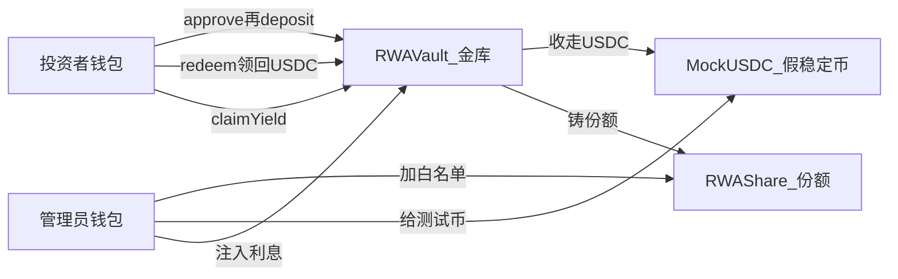

# 阶段 00 · 从 0 看懂：链、合约、RWA、本项目在干什么

> 对应计划第 1 节「项目定位与原理」。
> 本文按四部分组织：**1. 实现目标 → 2. 实现方法（概念） → 3. 手动实践 → 4. 重点关注和学习**。
> 本阶段**不写业务合约**，只把后面所有阶段共用的词儿先讲清楚。

---

## 1. 该阶段实现目标

一句话：

> **能用自己的话向组员讲清：我们要做的不是资料交易市场，而是一个「带准入的债券份额小金库」；以及为什么这件事适合用智能合约，而不是只用数据库。**

这对应作业 **R1 问题陈述**。评委先看你是否想明白用户和痛点，再看代码。

### 1.1 范围

| 在阶段 00 范围内 | 不在本阶段 |
|---|---|
| 钱包、地址、交易、Gas 是什么 | 安装 Hardhat、写 Solidity |
| 智能合约 vs 传统后端数据库 | ERC-20 源码细节（阶段 02） |
| 什么是 RWA、本项目模拟哪类资产 | Vault 申购赎回实现（阶段 03） |
| 三个合约各自干什么（口头版） | 前端 wagmi（阶段 05） |
| 作业 R1–R5 分别在考什么 | Sepolia 水龙头实操（阶段 07） |

### 1.2 交付线（DoD）

| # | 交付线 | 怎么验收 |
|---|---|---|
| 1 | 能画出「投资者 / 管理员 / 三个合约」关系 | 纸上或 Mermaid，别人能看懂 |
| 2 | 能说出 4 条「为何用合约」 | 可编程合规、原子结算、规则透明、按份额发息 |
| 3 | 能说出范围内 / 范围外 | 做白名单+申购赎回+暂停+**Admin setNAV**+简易派息；不做真 KYC、Chainlink、二级市场 |
| 4 | 知道作业五块评分各自对应后面哪一阶段 | 见下文 2.5 |

---

## 2. 实现方法（先把世界模型装进脑子）

### 2.1 区块链上你到底在操作什么

把以太坊想成一台**全世界共用的计算机**，状态（谁有多少币、谁在白名单）存在所有验证节点上，而不是存在你们小组的 MySQL 里。

你需要记住的最小词汇表：

| 词 | 类比 | 在本项目里的样子 |
|---|---|---|
| 账户 / 地址 | 银行卡号 | `0x` 开头的一串，MetaMask 里能看见 |
| 私钥 | 银行卡密码（绝不能给别人） | 只存在你钱包里，部署脚本也会用到（阶段 07） |
| 交易 | 一笔「请区块链执行某操作」的申请 | 加白名单、申购、赎回都是交易 |
| Gas | 手续费 | 测试网用假 ETH 付；没 ETH 交易发不出去 |
| 智能合约 | 部署到链上、规则公开的程序 | `MockUSDC` / `RWAShare` / `RWAVault` |
| 测试网 Sepolia | 演练场，币没有真实人民币价值 | 作业要求部署到这里 |
| 主网 | 真钱 | **本作业不做** |

读操作（查余额）通常不花 Gas；写操作（改状态）一定要发交易、付 Gas。

### 2.2 智能合约和数据库差在哪（R1 的核心）

传统系统：服务器改一行 SQL，用户不一定能发现，转让限制也可以被管理员偷偷关掉。

智能合约：

- 规则写在代码里，部署后**大家看到的是同一份逻辑**
- 「扣稳定币」和「给你份额」可以放在**同一笔交易**里，要么全成功要么全失败（原子性）
- 没在白名单，`transfer` 直接失败，不是前端藏一个按钮就算拦截

所以本项目不是「把债券名单存到链上当网盘」，而是把**准入 + 结算 + 领息规则**变成链上强制执行。

### 2.3 RWA 是什么，我们模拟哪一块

**RWA（Real World Assets）**：把链下真实资产（国债、发票、房产收益权）变成链上可持有的份额。

真实世界完整链路很长：律师、托管行、KYC 公司、审计。作业一个月做不完。我们只模拟其中**链上那一层**：

```text
链下（口头假设，不开发）：
  有一笔被托管的短期债券 / 应收账款

链上（本项目真正写代码）：
  份额代币 = 你对这笔资产的「数字凭证」
  白名单     = 假装已经 KYC 通过的人
  Vault      = 用假 USDC 换份额、再换回去、偶尔发点利息
```

对老师演示时要诚实：**白名单按钮 ≠ 真 KYC**；**MockUSDC ≠ 真美元**。价值在于展示「许可资产」和「原子申购赎回」怎么工作。

### 2.4 三个合约：一个小金库的三件套



| 合约 | 人话 | 关键能力 |
|------|------|----------|
| MockUSDC | 游戏里的「金币」 | 管理员可无限印，方便演示 |
| RWAShare | 「债券份额本」 | 不在名单不能拿、不能收 |
| RWAVault | 柜台 | 收金币给份额、收份额退金币、按持仓发利息 |

**净值（NAV）怎么做**：阶段 03 Vault 用 Admin `setNAV` 存当前净值（必做）。初始 `nav = 1e6` 时，存 100 假 USDC 得 100 份额（看起来像 1:1）；Admin 改价后按公式换算。这是**中心化喂价**，**不是** Chainlink 等外部预言机——报告必须写清。

### 2.5 作业评分项和阶段的对应

| 评分项 | 老师在看 | 主要落在 |
|--------|----------|----------|
| R1 问题陈述 | 谁痛、为何不用数据库 | 本阶段 + 报告 |
| R2 方案设计 | 链上/链下怎么切、流程图 | 00–05 的图 |
| R3 代码实现 | Solidity、事件、权限、Gas 习惯 | 02–05 |
| R4 测试与安全 | Slither、Echidna、威胁列表 | 06 |
| R5 部署运维 | Sepolia、验证、暂停/升级说明 | 07 |

参考作业里的 DEX、借贷只是**举例**。RWA 许可份额同样合格，只要 R1 写清楚「可编程资产 + 原子结算」。

---

## 3. 手动实践（不写代码也能做）

### 实验 1 · 装钱包，认识地址

1. 安装 [MetaMask](https://metamask.io/)
2. 建一个测试账户（不要用你有真钱的号做开发）
3. 把地址抄下来，观察它是 `0x` + 40 个十六进制字符

**预期**：你知道「以后所有白名单、mint、申购都是针对这个地址」。

### 实验 2 · 用自己的话写 200 字问题陈述草稿

按作业 R1 填空，不要抄术语堆砌：

- 用户是谁（发行方管理员、合规投资者）
- 痛点（传统登记里，准入和打款经常脱节；改库即可绕过限制）
- 为何合约（白名单写进 `transfer`；申购原子完成；派息按份额计算）
- 我们**不**做什么（真 KYC、上主网、法律文件）

**预期**：组员听完能复述，而不是只有你自己懂。

### 实验 3 · 画一张「范围内 / 范围外」表

把计划里的边界抄到纸上或文档里。以后有人想加 NFT、订单簿、IPFS，用这张表挡回去——作业原话是「范围要现实可行，创新性优先于系统规模」。

### 实验 4 · 浏览（先别深读）ethereum.org 教程首页

打开 [以太坊开发教程](https://ethereum.org/zh/developers/tutorials/)，记住有初级 / 中级 / 高级。阶段 01 起会点名哪些必做。现在只需知道：**教程是学习资料，不是本项目的全部功能清单。**

---

## 4. 重点关注和学习

### 4.1 先建立「状态机」直觉，再学语法

整个 DApp 就是改这几类链上状态：

- 某地址 USDC 多少
- 某地址份额多少
- 某地址在不在白名单
- 金库里锁了多少 USDC
- **当前净值 nav 是多少**（Admin `setNAV`）
- 系统有没有暂停
- 每人还能领多少利息

前端只是让人点这些状态变更。**状态想不清，Solidity 语法再熟也会写乱。**

### 4.2 本项目最重要的故事（2 分钟演示）

后面所有代码都为这四步服务：

1. Admin 给地址 A 加白名单，并 mint 假 USDC 给 A
2. A 申购 → 得到份额
3. A 转给未白名单的 B → **失败**
4. 给 B 加白名单后再转 → **成功**；A 还可以领息、赎回

老师看懂「这和随便转的 ERC-20 不同」，R1 就立住了。

### 4.3 和旧仓库 DataCoin 的关系

当前仓库是「用 DATA 币买资料、自动分账」。计划是**换成 RWA 三合约**，资料上传 / IPFS / 下载解锁全部不做。

原因：DataCoin 很多时间耗在链下文件；RWA 把时间留给链上权限和资金流，也更接近你们后面想做的「智能合约漏洞检测」。

### 4.4 建议的心理预期（从 0）

- 阶段 00：只要求「能讲」
- 阶段 01：要求「能部署 Hello World」
- 阶段 02 起：才进入本项目业务代码
- 看不懂源码时，先回到本阶段的图，问「这笔交易改了哪几个状态」

---

## 5. 决策与产物小结

**关键决策**（计划已定，本阶段只需理解）：

- 做 RWA 标准版，而不是做完 DataCoin，也不是做完整证券化平台
- 用白名单模拟 KYC，用 MockUSDC 模拟美元
- 用 **Admin `setNAV`** 模拟净值（必做）；不接 Chainlink；初始 nav=1e6 便于从「像 1:1」起步

**本阶段产物**：问题陈述草稿、角色关系图、范围表。还没有合约代码，这是正常的。
