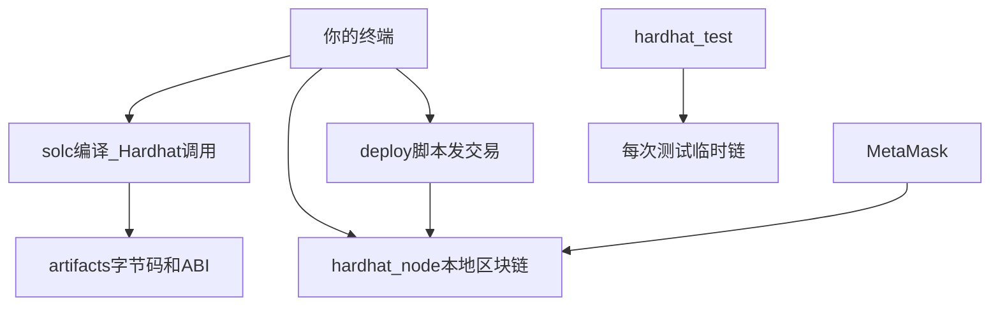

# 阶段 01 · 工程脚手架：从 0 跑通「编译 → 测试 → 本地链 → 部署」

> 对应计划第 2 节技术栈、第 10 节第 1 周前半。
> 本文按四部分组织：**1. 实现目标 → 2. 实现方法 → 3. 手动实践 → 4. 重点关注和学习**。
> 本阶段目标是 **工具链真通**；业务仍可以是 Hello World / 现有 DataCoin，不要求 RWA 逻辑已经写完。

---

## 1. 该阶段实现目标

一句话：

> **在自己电脑上：编译 Solidity、跑测试、开一条本地链、把合约部署上去，并用钱包连上这条链。**

对应作业 **R3** 的「学习 Solidity、Hardhat」和 **R5** 的「可复现部署脚本」的雏形（先本地，测试网留阶段 07）。

### 1.1 范围

| 在范围内 | 不在本阶段 |
|---|---|
| Node.js、仓库 `npm install`、Hardhat | 白名单、Vault、派息 |
| `npx hardhat compile` / `test` / `node` | Slither / Echidna |
| MetaMask 添加 Localhost 31337 | Sepolia、Etherscan 验证 |
| 跟完 Hello World 教程 | 改完前端三页 |
| 看懂现有 `package.json` 脚本 | 删除 DataCoin（可留到阶段 02 再换） |

### 1.2 交付线（DoD）

| # | 交付线 | 验收 |
|---|---|---|
| 1 | 根目录依赖装好，`npm run compile` 成功 | 终端无报错，生成 `artifacts/` |
| 2 | `npm test` 能跑（即使测的还是旧合约） | 知道测试是「本地模拟链上调用」 |
| 3 | `npm run node` 常驻 + 另一窗口 `deploy:local` | 打印出合约地址 |
| 4 | MetaMask 能切到 Chain ID 31337 | 能看见 Hardhat 预置账户（可选导入私钥） |

---

## 2. 实现方法

### 2.1 本仓库已经有什么（先认门）

项目根目录（Hardhat）和 `frontend/`（React）是**两套 npm 项目**。

根目录 [package.json](../../package.json) 里现在有：

- `compile`：把 `.sol` 编译成字节码 + ABI
- `test`：跑 `test/` 下的测试
- `node`：启动本地以太坊（Hardhat Network，Chain ID 默认 31337）
- `deploy:local`：在本地链上部署脚本
- 依赖：`hardhat`、`hardhat-toolbox`、`openzeppelin/contracts`

前端另有 `wagmi` / `viem` / `vite`。阶段 01 以根目录合约工具链为主，前端连钱包可试，页面业务等阶段 05。

### 2.2 一条本地链上到底发生了什么



- **编译**：Solidity → 机器能部署的 bytecode；同时生成 **ABI**（函数名、参数类型的说明书）。前端以后靠 ABI 才知道有 `deposit` 这个函数。
- **Hardhat Network**：电脑里的假链，出块很快，ETH 免费。关掉 `hardhat node` 进程，链上状态就没了。
- **测试**：每次 `npm test` 往往自带一条临时链，测完即毁，不必先开 `node`。
- **部署脚本**：用某个账户（本地默认是 Hardhat 给的有钱账户）发「创建合约」交易。

### 2.3 为什么选 Hardhat 而不是 Remix 或 Foundry

- **Remix**：浏览器里写合约，适合阶段 00–01 的 Hello World 入门，但作业要可复现脚本、测试、后面接前端，最终仍要回到仓库。
- **Foundry**：很多审计/安全向项目爱用，计划明确 **不换**，避免从 0 同时学两套工具。
- **Hardhat**：本仓库已有，和 JavaScript 测试、部署脚本同一语言，前端同学也更好看懂。

### 2.4 你必须建立的安全习惯（越早越好）

- 开发用**单独** MetaMask 账户 / 单独浏览器配置
- 私钥、`.env` **永远不要**提交 Git、不要发到群里
- Hardhat 文档里的示例私钥只在 **localhost** 用；拷到主网等于把钱送人

---

## 3. 手动实践

### 实验 1 · 跑通本仓库现有骨架

在 `d:\Code\data-coin-marketplace`：

```bash
npm install
npm run compile
npm test
```

**预期**：编译通过；测试通过或你能看懂失败原因（旧测试依赖旧合约时，记录下来，阶段 02 会换）。

另开终端：

```bash
npm run node
```

保持这个窗口不要关。再开一个窗口：

```bash
npm run deploy:local
```

**预期**：打印合约地址。把地址理解成「这个程序在链上的门牌号」。

### 实验 2 · ethereum.org Hello World（补零基础）

按顺序做（中文站）：

1. [Getting Started with Ethereum Development](https://ethereum.org/zh/developers/tutorials/getting-started-with-ethereum-development-using-alchemy/)
2. [Hello World Smart Contract](https://ethereum.org/zh/developers/tutorials/hello-world-smart-contract/)
3. [Deploying your first smart contract](https://ethereum.org/zh/developers/tutorials/deploying-your-first-smart-contract/)

**过关标准**：你曾亲手部署过一个会改状态的合约（不一定是本仓库），并且用钱包或 Remix 调用过一次。

Alchemy 若注册麻烦，本阶段用 Hardhat 本地链即可，不必绑定真实 RPC。

### 实验 3 · MetaMask 连本地链

1. 添加网络：RPC `http://127.0.0.1:8545`，Chain ID `31337`，货币符号 `ETH`
2. （可选）导入 `hardhat node` 打印的某个测试账户私钥，能看到 10000 ETH

**预期**：以后点「申购」时，MetaMask 弹窗就是在向这条链签名。

### 实验 4 · 打开一份合约，只认三样东西

打开 [contracts/DataCoin.sol](../../contracts/DataCoin.sol)，现阶段只认：

- `pragma solidity`：语言版本
- `contract DataCoin is ERC20, Ownable`：继承了「代币标准 + 只有主人能铸币」
- `function mint ... onlyOwner`：带权限的写函数

看不懂 OpenZeppelin 源码没关系，阶段 02 会讲 ERC-20。

---

## 4. 重点关注和学习

### 4.1 ABI 是前后端的合同

前端不会去「读 Solidity 源码」。它拿 JSON 版 ABI，按名字调函数。阶段 05 的 `frontend/src/abi/` 就是这个合同。**合约函数改名或改参数，前端 ABI 必须一起更新。**

### 4.2 本地链和测试网的差别（先有印象）

| | Hardhat 本地 | Sepolia |
|--|-------------|---------|
| ETH | 免费无限 | 水龙头申请，有限额 |
| 重置 | 重启 node 就没了 | 交易永久可查 |
| 速度 | 秒级 | 要等出块 |
| 作业 | 开发日常 | R5 必须交 |

阶段 01 只要求本地；不要过早陷入水龙头和验证。

### 4.3 编译错误怎么读

常见从 0 会遇到：

- 版本不一致：`pragma` 和 `hardhat.config` 的 solc 版本
- 找不到 OpenZeppelin：根目录没 `npm install`
- 部署失败 `nonce`：本地 chain 重启了但 MetaMask 还记着旧 nonce → 重置账户活动

记一条：**报错先看最后几行英文，复制去搜，比从第一行开始慌更有效。**

### 4.4 延伸（现在不用做）

- Hardhat 如何用 `ethers` 在脚本里签交易
- `artifacts/contracts/...json` 里面 `bytecode` 和 `abi` 字段
- 为什么测试用 `loadFixture` 可以加速、可重复

---

## 5. 决策与产物小结

**决策**：沿用现有 Hardhat + OZ + 本地 31337，不平行引入 Foundry。

**产物**：能复现的本地编译/测试/部署；钱包连上本地链；Hello World 教程过关。

**下一阶段**：开始写 `MockUSDC` 和带白名单的 `RWAShare`。
