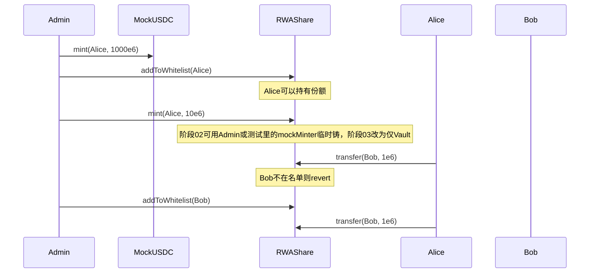

# 阶段 02 · 许可代币：MockUSDC + 白名单份额 RWAShare

> 对应计划 5.1、5.2 与第 1 周后半。
> 本文按四部分组织：**1. 实现目标 → 2. 实现方法 → 3. 手动实践 → 4. 重点关注和学习**。
> 本阶段结束后，**还没有申购柜台**；只有「金币」和「不能随便转的份额本」。

---

## 1. 该阶段实现目标

一句话：

> **链上出现两种 ERC-20：一种谁拿到都能转（假 USDC）；一种必须先被管理员列入白名单才能持有或接收（RWAShare）。**

这是 RWA 和普通「发个币」作业的差别，也是 2 分钟演示里「转给路人失败」的技术来源。对应 **R3** 的 ERC-20、`onlyOwner`/角色、事件。

### 1.1 范围

| 在范围内 | 不在本阶段 |
|---|---|
| `MockUSDC`：6 位小数、Admin mint | Vault 申购赎回 |
| `RWAShare`：白名单、`_update` 拦截 | 派息指数 |
| `addToWhitelist` / `remove` / 批量 `calldata` | 前端管理页（可先用脚本） |
| mint/burn **仅预留给将来的 Vault** | 真 USDC、Circle 对接 |
| 单测：非白名单 transfer 失败 | Slither 全项目报告 |

### 1.2 交付线（DoD）

| # | 交付线 | 验收 |
|---|---|---|
| 1 | 部署后 Admin 能 mint MockUSDC 给任意地址 | 测试或脚本 |
| 2 | 未白名单地址无法 `transfer` / `transferFrom` 份额 | 测试断言 revert |
| 3 | 白名单地址之间可以转份额 | 测试通过 |
| 4 | 增删白名单发出 `WhitelistUpdated` | 测试能捕获事件 |
| 5 | 普通投资者不能 mint 份额 | 无 MINTER_ROLE 则失败 |

---

## 2. 实现方法

### 2.1 ERC-20 是什么（人话）

ERC-20 是「同质代币」的接口约定：大家都实现 `balanceOf`、`transfer`、`approve`、`transferFrom` 等。钱包和前端才能用同一套按钮对待不同的币。

必懂的两对动作：

| 动作 | 含义 |
|------|------|
| `transfer(to, amount)` | 我把自己的币直接转给你 |
| `approve(spender, amount)` + 对方 `transferFrom(我, 某处, amount)` | 我授权某个合约/地址最多扣我这么多；**下一阶段 Vault 申购全靠这个** |

`decimals`：USDC 常用 **6**（1 美金 = `1_000_000` 最小单位）。计划锁定 6，避免和 18 位 ETH 搞混。展示时前端要除以 `10^6`。

教程必读：

- [Understand the ERC-20 token smart contract](https://ethereum.org/zh/developers/tutorials/understand-the-erc-20-token-smart-contract/)
- [ERC-20 with Safety Rails](https://ethereum.org/zh/developers/tutorials/erc20-with-safety-rails/)（限制转账，最贴近本阶段）
- [Sending Tokens Using ethers.js](https://ethereum.org/zh/developers/tutorials/send-token-ethersjs/)

### 2.2 为什么份额必须「许可」

普通 ERC-20：任何人可接收。证券、债券份额通常要求：**只有合格投资者能持有**。

实现策略（标准版，不是完整 ERC-3643）：

- `mapping(address => bool) whitelist`
- OpenZeppelin ERC20 在转账、铸、烧时都会走 `_update(from, to, value)`
- 规则：
  - `from != 0 && to != 0`：双方都要在白名单（用户互转）
  - `from == 0`：铸造，只要求 `to` 在白名单（Vault 给投资者铸币）
  - `to == 0`：销毁，只要求 `from` 在白名单（赎回烧掉）

零地址 `address(0)` 表示「铸/烧」，不是一个真人。

### 2.3 权限：AccessControl 比单个 owner 更贴作业

计划用 OpenZeppelin `AccessControl`：

| 角色 | 谁 | 能做什么 |
|------|-----|----------|
| `DEFAULT_ADMIN_ROLE` | 部署者 | 授角色、管白名单 |
| `MINTER_ROLE` / `BURNER_ROLE` | **只给 Vault 合约地址** | 铸/烧份额 |

投资者永远不该能自己 `mint` 份额，否则等于印债券。

`MockUSDC.mint` 可以继续 `Ownable` 或同一套 Admin，作业演示用。

### 2.4 事件（R3 硬性）

至少：

```text
event WhitelistUpdated(address indexed account, bool allowed);
```

铸币/转账 ERC20 自带 `Transfer`。报告里要写：前端和 Etherscan 都靠事件还原历史，而不是轮询全部存储。

### 2.5 数据流（本阶段）



阶段 02 测试里可以给测试合约临时 minter，避免还没写 Vault。阶段 03 部署脚本要把 minter **换成 Vault 并收回测试权限**。

---

## 3. 手动实践

### 实验 1 · 读懂并改一个「安全轨道」ERC-20

完成 Safety Rails 教程后，用自己的话回答：

- `_beforeTokenTransfer` / `_update` 在哪一刀拦住了谁
- 如果只检查 `to` 不检查 `from`，会发生什么漏洞（已在名单的人转给路人）

### 实验 2 · 为本仓库写两个失败测试（建议 TDD）

在实现完整逻辑前，先写测试（Hardhat）：

1. 用户不在白名单，`transfer` 必须失败
2. 非 minter 调用 `mint` 必须失败

跑 `npx hardhat test` 看到 **红**，再写最小合约让它变绿。这和参考项目「先写失败测试」同一精神，也方便以后做漏洞检测时当回归用例。

### 实验 3 · 批量加白名单用 `address[] calldata`

作业 Gas 项：只读参数优先 `calldata`。Admin 可提供：

`addToWhitelistBatch(address[] calldata accounts)`

内部 `for` 只遍历传入数组（长度有限，由 Admin 控制），**不要**在链上 `for` 遍历「所有投资者」——那是无界循环，阶段 04 派息会再强调。

### 实验 4 · 用脚本代替前端做演示

还没有管理页时，用 `scripts/` 调 `addToWhitelist` 和 `mint`。过关：本地 node 上能完成「A 能转、B 不能收」。

---

## 4. 重点关注和学习

### 4.1 approve 的坑（为阶段 03 预习）

`approve` 不是转账。用户先授权 Vault「最多扣 100 USDC」，再调 `deposit`。授权过大有风险；教学上可每次授权当次额度。`SafeERC20` 在 Vault 里用，本阶段先理解语义即可。

### 4.2 为什么不能在 constructor 里把所有人都设成白名单

那就不是许可代币了。零地址、死地址误转也会出事故。默认 **全员 false**，Admin 显式添加。

### 4.3 和 ERC-3643 的关系（面试可说、作业不做完）

ERC-3643 是更完整的许可代币标准（身份注册表、合规模块）。本项目用「白名单 mapping + `_update`」表达**同一思想的最小切片**。报告里写「思路对齐、实现简化」，不要声称已完整实现标准。

### 4.4 延伸问题（自己查）

- `transferFrom` 是否也走 `_update`？（走，所以白名单对授权转账同样生效）
- 若用户把自己移出白名单但余额还在，还能不能转出？
- `decimals = 6` 时测试里 `parseUnits("1", 6)` 和 `parseEther("1")` 的区别

---

## 5. 决策与产物小结

**决策**：

- MockUSDC 6 decimals；份额同样 6；阶段 03 的 `nav` 也用 6 位缩放（`1e6` = 1 份额兑 1 USDC）
- 许可逻辑集中在 `_update`，避免漏掉 `transferFrom`
- Vault 尚未存在时，测试可授予临时代码 minter，部署流程在阶段 03 收回

**产物**：`contracts/MockUSDC.sol`、`contracts/RWAShare.sol`、对应测试；旧 `DataCoin.sol` 可在本阶段末删除或移到 `legacy/`，避免作业范围混乱。

**下一阶段**：金库 `RWAVault`——用假 USDC 换份额。
