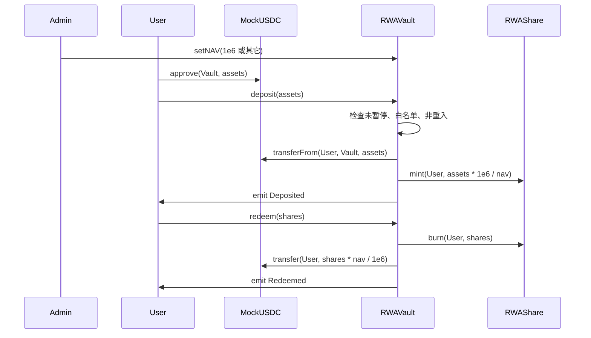

# 阶段 03 · 金库 Vault：申购、赎回、暂停、Admin setNAV

> 对应计划 5.3、核心时序图、第 2 周；净值见技术设计 §6.6。  
> 本文按四部分组织：**1. 实现目标 → 2. 实现方法 → 3. 手动实践 → 4. 重点关注和学习**。  
> 这是标准版的**主闭环**：没有派息也能交一份能演示的 RWA；**`setNAV` 必做，不可降级**。

---

## 1. 该阶段实现目标

一句话：

> **投资者授权后把假 USDC 打进金库，金库按当前净值 `nav` 铸造份额；赎回则烧掉份额并按 `nav` 退回 USDC。管理员能 `setNAV`、能暂停柜台。整笔要么全成要么全败。**

对应 **R1 原子结算**、**R2 价值流转在链上**、**R3 合约互操作 / 事件 / 非重入**、**R5 暂停方案**；净值用 **Admin 中心化喂价** 模拟，**不接** Chainlink。

### 1.1 范围

| 在范围内（必做） | 不在本阶段 |
|---|---|
| `deposit(assets)` / `redeem(shares)` | 分红指数（阶段 04） |
| **`setNAV(newNav)` + 读 `nav`**；按 nav 换算份额/USDC | Chainlink / 外部预言机 |
| 部署初始 `nav = 1e6`（此时行为等于 1:1） | 二级市场买卖份额 |
| `Pausable`：暂停申购赎回（建议 setNAV 也挂 whenNotPaused） | 可升级 Proxy |
| `ReentrancyGuard` + SafeERC20 | 真实托管划款 |
| 事件 `Deposited` / `Redeemed` / `Paused` / **`NavUpdated`** | 前端精修（阶段 05 接线） |

### 1.2 交付线（DoD）

| # | 交付线 | 验收 |
|---|---|---|
| 1 | 白名单用户：approve → deposit → USDC 减少、份额按公式增加、Vault 中 USDC 增加 | 测试 |
| 2 | 未 approve 或未白名单：deposit revert | 测试 |
| 3 | redeem 后份额销毁、USDC 按当前 nav 回到用户 | 测试 |
| 4 | **Admin `setNAV` 成功并发 `NavUpdated`；非 Admin 调用失败** | 测试 |
| 5 | **改 nav 后，同样 assets 得到的 shares（或赎回额）随之变化** | 测试 |
| 6 | pause 后 deposit/redeem 失败，unpause 恢复 | 测试 |
| 7 | 部署脚本：USDC → Share → Vault（初始 nav=1e6），并把 Share 的 minter/burner 设为 Vault | 本地可复现 |

---

## 2. 实现方法

### 2.1 Vault 是什么

Vault（金库）= **保管资产的合约**。用户不是把 USDC 转给管理员私人地址，而是转给合约地址。规则由代码执行。

```text
deposit:  用户 USDC  --转入--> Vault
          shares = assets * 1e6 / nav
          Vault     --mint-->  用户 RWAShare

redeem:   用户份额   --burn-->
          assetsOut = shares * nav / 1e6
          Vault USDC --转回--> 用户
```

「原子」：扣款与铸币（或烧份额与退款）写在同一函数里。失败则整笔回滚。

### 2.2 净值 `nav`（必做）

- 缩放：与 MockUSDC 相同，**6 位小数**；`1e6` 表示 1 份额 = 1 USDC  
- 仅 Admin：`setNAV(uint256 newNav)`，`newNav > 0`，`emit NavUpdated(old, new)`  
- **不是** Chainlink：报告必须写「中心化喂价 / Admin 信任假设」

换算口诀：

| nav | 存 100e6 USDC 约得份额 |
|-----|------------------------|
| `1e6`（默认） | 100e6（看上去像 1:1） |
| `2e6`（份额更「贵」） | 50e6 |
| `5e5`（份额更「便宜」） | 200e6 |

上调 nav 后赎回同一份额会兑出更多 USDC → 金库要有足够余额，演示前可先注资。

### 2.3 标准调用顺序（投资者视角）



教程：

- [Transfers and approval of ERC-20 from Solidity](https://ethereum.org/zh/developers/tutorials/transfers-and-approval-of-erc-20-tokens-from-a-solidity-smart-contract/)
- [Interact with other contracts from Solidity](https://ethereum.org/zh/developers/tutorials/interact-with-other-contracts-from-solidity/)
- [Logging events](https://ethereum.org/zh/developers/tutorials/logging-events-smart-contracts/)

### 2.4 Checks-Effects-Interactions 与重入

1. **Checks**：暂停？白名单？余额够不够？`nav > 0`？  
2. **Effects**：先改份额会计 / 先 burn  
3. **Interactions**：再 `transfer` USDC  

并加上 `nonReentrant`。

### 2.5 暂停（R5）

- `pause()` / `unpause()` 仅 Admin  
- `whenNotPaused` 挂在 `deposit` / `redeem`（建议 `setNAV` 也挂上；阶段 04 的派息同样建议）

报告写：不可升级 + pause 止损；Admin 能暂停也能改 NAV，属中心化取舍，诚实披露。

### 2.6 状态守恒（为 Echidna 打基础）

- `nav == 1e6` 且无派息：`USDC.balanceOf(Vault) == RWAShare.totalSupply()`  
- nav 可变：`USDC.balanceOf(Vault) >= totalSupply * nav / 1e6`（改价后不够则先注资或限制 setNAV）  
- 阶段 04 注入利息后，Vault USDC 还要覆盖未领利息

### 2.7 链上 vs 链下（R2）

| 链上 | 链下 |
|------|------|
| 谁存了多少、金库锁了多少、**当前 nav** | 按钮、输入框、「假设底层债券涨了所以 Admin 改净值」的讲稿 |
| 暂停开关 | 「请先加白名单」提示 |

文件存储、KYC 证件、真实预言机网络：**不做**。

---

## 3. 手动实践

### 实验 1 · 没授权就 deposit

只调 `deposit` 不 `approve`，期望 revert。

### 实验 2 · 白名单

A 在名单、B 不在。B 不能 deposit；A 成功后再 `transfer` 给 B 仍应失败。

### 实验 3 · setNAV（必做）

1. 初始 `nav == 1e6`，deposit 100e6 → 份额约 100e6  
2. Admin `setNAV(2e6)`，再 deposit 100e6 → 份额约 50e6  
3. 非 Admin 调 `setNAV` → revert  
4. 捕获 `NavUpdated`

### 实验 4 · 暂停开关

Admin `pause` 后 deposit/redeem 失败；`unpause` 后恢复。

### 实验 5 · 部署脚本顺序

1. MockUSDC  
2. RWAShare  
3. RWAVault(usdc, share)（构造里 `nav = 1e6`）  
4. `grantRole(MINTER/BURNER, vault)`  
5. 打印地址（含说明可 `setNAV`）

---

## 4. 重点关注和学习

### 4.1 为何用 Admin setNAV 而不是 Chainlink

作业要展示「真实 RWA 有净值」的思想，但不引入外部喂价、节点心跳、测试网 feed 地址等复杂度。Admin `setNAV` = **最小可演示的中心化预言机替代品**。报告写清边界，比假装接了 Chainlink 更诚实。

### 4.2 `msg.sender` 是谁

用户调 Vault 时 `msg.sender` 是用户；Vault 调 Share.mint 时 Share 看到的是 **Vault**，故 minter 必须是 Vault。

### 4.3 NAV 与派息不要混

改 nav ≠ 自动发息。利息走阶段 04 的 `distributeYield` / `claimYield`。双轨记账，避免双重计算。

### 4.4 延伸

- ERC-4626 金库标准可对比阅读；本项目是教学简化版  
- 真实产品还会考虑 NAV 更新频率、熔断、多签喂价——作业点到为止

---

## 5. 决策与产物小结

**决策**：不可升级 + Pausable；**按 nav 计价（必做 setNAV）**；初始 1e6；不接 Chainlink；先做资金闭环再做利息。

**产物**：`RWAVault.sol`（含 `setNAV`）、Vault 测试（含改价用例）、更新后的 `scripts/deploy.js`。

**降级线**：派息可降级；**setNAV 不可降级**。时间不够时停在本阶段 + 前端（含 NAV）+ 安全部署。

**下一阶段**：在「金库里多出来的 USDC」上做按份额领息（与 nav 本金轨分开）。
