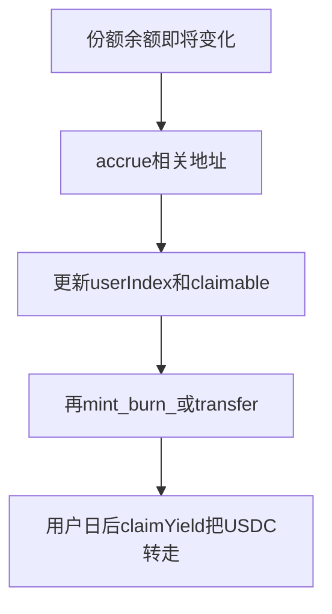

# 阶段 04 · 简易派息：分红指数（pull，禁止给所有人 for 循环转账）

> 对应计划 5.4 与第 3 周前半。标准版与「仅简化版」的分界线。
> 本文按四部分组织：**1. 实现目标 → 2. 实现方法 → 3. 手动实践 → 4. 重点关注和学习**。
> 若本周超时：代码可不合并，但建议仍读完原理，把公式写进报告「下一阶段」。

---

## 1. 该阶段实现目标

一句话：

> **管理员把一笔利息 USDC 打进金库；每个持有份额的人之后自己来领，金额与其份额成正比。合约绝不遍历全部投资者打款。**

对应 **R3 Gas：避免无边界循环**，以及 RWA 故事里的「收益分配」。

### 1.1 范围

| 在范围内 | 不在本阶段 |
|---|---|
| `distributeYield(amount)` | 用 `setNAV` 代替发息、把利息滚进净值（本项目双轨分开，禁止混用） |
| `claimYield()` 用户来领 | 按日定时链下 cron 发息 |
| `rewardIndex` 累加 | 多资产、多档份额 |
| 份额转让前先结息（accrue） | 二级市场溢价 |

### 1.2 交付线（DoD）

| # | 交付线 | 验收 |
|---|---|---|
| 1 | 两人各持 50% 份额，注入 100 USDC 利息，每人可领 50 | 测试允许 1 单位误差 |
| 2 | 无人持仓时 `distributeYield` 应 revert 或明确拒绝 | 避免除零 |
| 3 | 用户 A 把份额转给 B 前，A/B 都先结算，避免把未领息带走/丢失 | 测试 |
| 4 | `distributeYield` / `claimYield` 有事件 | 测试 |
| 5 | 注入利息后 `usdc.balanceOf(vault) >= totalSupply + 会计上的未领利息` | 测试或 Echidna 预备 |

---

## 2. 实现方法

### 2.1 为什么不能 `for (i < investors.length) transfer`

投资者人数会增长，Gas 会超块限制，交易失败；也容易漏人。作业点名禁止这类写法。

改成 **pull（拉取）**：合约只更新一个全局数字，用户自己调 `claimYield` 把钱拉走。

### 2.2 分红指数在干什么（用小学比例）

把所有份额看成一块蛋糕。新来的利息要按「当前各自身上的蛋糕块」分配。

维护一个放大了的全局指数 `rewardIndex`（乘 `1e18` 是为了除法别过早变成 0）：

```text
每次注入利息 amount：
  rewardIndex += amount * 1e18 / share.totalSupply()
```

每个用户记住自己上次结算时的指数 `userIndex[user]`。待领：

```text
delta = rewardIndex - userIndex[user]
owed  = share.balanceOf(user) * delta / 1e18
```

结算后把 `userIndex[user] = rewardIndex`，并把 `owed` 记到 `claimable[user]` 或当场累加后再 claim。

**直觉**：指数上升表示「每一份份额又多值多少利息」。你持有 10 份，指数涨了，你就按 10 份领取。

### 2.3 必须在份额变化之前 accrue

如果用户先把份额转走再结算，会出现：

- 卖方：利息期间持有过，但余额已变成 0，算出来是 0（亏）
- 买方：刚收到份额却领到卖方那一段时间的息（亏卖方、赚买方）

所以在这些动作**之前**对相关地址 `_accrue`：

- `deposit` / `redeem` / `claimYield`
- `RWAShare` 用户互转：`from` 和 `to` 都 accrue

计划中的挂钩：Share 的 `_update` 在双方都非零时调用 `IVault.accrue(from)` 和 `accrue(to)`。要注意：

- mint/burn 时 Vault 已经在 deposit/redeem 里 accrue 了，避免死循环或重复
- `accrue` 应做成外部可被 Share 调用、但**不能随便让人把会计改乱**（通常只改该用户的指数与 claimable，不转出资金）



### 2.4 资金守恒（派息之后）

```text
Vault 中的 USDC
  = 所有份额按当前 nav 计价的本金索取（约 totalSupply * nav / 1e6）
  + 已注入但用户还没 claim 的利息
  + （若 claim 已转走则不含）
```

Admin 注入利息必须先 `approve` Vault，再 `distributeYield`，Vault `transferFrom` Admin。不要直接误转到 Share 合约地址。

### 2.5 暂停与权限

- 仅 Admin `distributeYield`（不然谁都可以假装发息、搅乱指数——若他们还能打入 USDC 则变成捐赠；仍应限制以免乱序）
- `claimYield` 任何白名单持有人可调
- 暂停期间建议：停止 deposit/redeem/distribute；claim 是否允许「暂停时仍能领出利息」要在实现时定一条并写进文档。推荐：**暂停时连 claim 一并停**，止损简单，报告写清。

---

## 3. 手动实践

### 实验 1 · 纸上算一笔账

t0：A 存 100，B 存 100，index = 0  
t1：注入 20 利息 → 每份增加 `20/200`  
A 可领 10，B 可领 10  
t2：A 再存 100（先给 A accrue 领权 10）  
t3：再注入 30，按新 totalSupply 300 分  

自己用计算器算 A、B 该领多少，**先当测试的 expected**。指数实现很容易 off-by-one，纸算是救星。

### 实验 2 · 单元测试按实验 1 的数字写死

允许 1 最小单位的舍入差（`1e18` 整数除法）。如果差很多，是公式或 accrue 顺序错了，不是「Solidity 随机」。

### 实验 3 · 转让夹心

A 持有期间注入利息，再 `transfer` 一半给 B。断言：A 仍能 claim 转让前那一段；B 不能领 A 那一段。

### 实验 4 · （可选）对比错误实现

写一个**不会提交**的伪代码：`for` 所有人 `transfer`。在报告里当反面教材，说明为何 Gas 不合格。

---

## 4. 重点关注和学习

### 4.1 整数除法

Solidity 没有小数。先乘后除，并用 `1e18` 放大。仍会有灰尘金额留在合约里，报告可承认「舍入尘埃归金库」，不要假装 0 误差。

### 4.2 和漏洞检测的关系

分红指数 + 转让钩子是经典易错区：漏 accrue、重入 claim、index 更新顺序错误。阶段 06 的 Echidna 不变量（「非白名单余额为 0」「金库 USDC 够兑付本金+未领息」）会直接打这里。后面若做检测项目，优先扫描这类会计函数。

### 4.3 抢先交易（R4 第五项预告）

若 Admin 公开「即将发息」，机器人可能抢先买份额、领完再卖。1:1 无二级市场时该攻击弱；报告仍要写「若将来开放自由交易，发息需考虑时间锁或快照」。诚实加分。

### 4.4 延伸

- MasterChef / 很多 DeFi 挖矿用同一套 `accRewardPerShare`
- ERC-4626 的 `profit` 注入与 share 稀释是另一类模型，不要混进本作业代码

---

## 5. 决策与产物小结

**决策**：pull + rewardIndex；Share 转让挂钩 accrue；**NAV（`setNAV`）与派息分轨**——改净值 ≠ 自动发息；阶段 03 已必做 setNAV，本阶段只加利息账。

**产物**：Vault 中派息相关函数、Share 回调、针对性测试。

**降级**：未完成则报告画公式、代码注释 `TODO`，主路径仍以阶段 03 演示。

**下一阶段**：三页前端把这些函数变成按钮。
