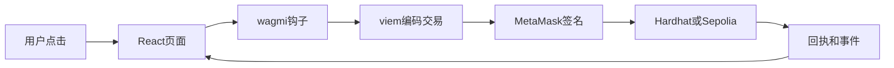

# 阶段 05 · 前端 DApp：钱包、三页、把交易点出来

> 对应计划第 7 节与第 3 周后半。
> 本文按四部分组织：**1. 实现目标 → 2. 实现方法 → 3. 手动实践 → 4. 重点关注和学习**。
> UI 不评分成「好不好看」，评分看 **R2：繁重 UI 在链下、价值流转在链上**，以及演示能否点通。

---

## 1. 该阶段实现目标

一句话：

> **浏览器连上 MetaMask，能读余额/白名单/NAV，能发出 approve、deposit、redeem、claim，Admin 能加名单、mint 测试币、setNAV、注入利息、暂停。**

### 1.1 范围

| 在范围内 | 不在本阶段 |
|---|---|
| Home / Invest / Admin 三页 | IPFS、图表站、The Graph |
| wagmi `readContract` / `writeContract` | 自己写 JSON-RPC 底层 |
| 本地 31337 + 为 Sepolia 留 env | 漂亮设计系统 |
| 交易 pending / 成功 / 失败提示 | 移动端适配 |

现有 [frontend/](../../frontend/) 已是 React + Vite + wagmi + viem，改页面和 ABI，不必新脚手架。

### 1.2 交付线（DoD）

| # | 交付线 | 验收 |
|---|---|---|
| 1 | 连接钱包后看到地址、USDC、份额、是否白名单、**当前 NAV** | 截图可进报告 |
| 2 | 投资者走通 approve + deposit（预估份额随 nav 变） | 链上余额变化 |
| 3 | redeem / claim（若已实现派息）可用 | 同上 |
| 4 | Admin 可 **setNAV**；非管理员禁用或提示 | 非 Admin 调用被合约拒绝 |
| 5 | `.env` 三个合约地址 + `VITE_CHAIN_ID` | 换本地/Sepolia 只改环境变量 |

---

## 2. 实现方法

### 2.1 前端在架构里的位置



React **不保管私钥**。它构造「我想调 Vault.deposit(100)」；钱包弹窗；用户确认；节点执行合约。

教程：

- [Calling a smart contract from JavaScript](https://ethereum.org/zh/developers/tutorials/calling-a-smart-contract-from-javascript/)
- [Building a user interface for your contract](https://ethereum.org/zh/developers/tutorials/creating-a-wagmi-ui-for-your-contract/)
- [Hello World Fullstack](https://ethereum.org/zh/developers/tutorials/hello-world-smart-contract-fullstack/)

### 2.2 页面职责

| 页面 | 读 | 写 |
|------|----|----|
| Home | 余额、白名单、是否暂停、**当前 NAV**、待领利息 | 无或仅「刷新」 |
| Invest | **按 nav 预估**可得份额 / 赎回 USDC | approve、deposit、redeem、claimYield |
| Admin | 暂停状态、当前 NAV | 白名单增删、mint USDC、**setNAV**、distributeYield、pause/unpause |

旧的市场 / 上架 / 资料详情页删除或改路由，避免老师点到废弃功能。

### 2.3 读 vs 写

- **读**：`balanceOf`、`whitelist`、`paused`、`nav`、`claimable` —— 一般不弹钱包、不花 Gas
- **写**：改状态 —— 必弹窗、必 Gas（Admin 含 `setNAV`）

申购是两笔写（若额度不够）：先 `approve`，等成功，再 `deposit`。UI 上要写成两步或检测 allowance 自动提示。不要指望一笔「元交易」在标准 ERC-20 里完成（permit 不在范围内）。

### 2.4 ABI 与地址从哪来

1. `npx hardhat compile` 后 `artifacts/contracts/RWAVault.sol/RWAVault.json` 里有 abi
2. 拷到 `frontend/src/abi/*.ts`
3. 地址来自部署打印，写入 `frontend/.env`：

```env
VITE_MOCK_USDC_ADDRESS=0x...
VITE_RWA_SHARE_ADDRESS=0x...
VITE_RWA_VAULT_ADDRESS=0x...
VITE_CHAIN_ID=31337
```

Hardhat node 一重启，地址会变，要重新 deploy 并改 env。这不是 bug。

### 2.5 数据流（用户申购）

```text
输入框 100 USDC
  → 换成 100 * 10^6 的整数
  → 读 allowance，不足则 write approve
  → write deposit(100e6)
  → 等 receipt
  → 再读 balanceOf 刷新页面
```

decimals 搞错会「点了 100 实际是 100 个最小单位」，演示会很难看。封装一个 `parseUnits(value, 6)`。

---

## 3. 手动实践

### 实验 1 · 只连钱包、只读余额

先不要写申购。Home 显示 USDC/份额为 0 也算成功。确认 Chain ID 不对时有提示（连着主网会调错合约）。

### 实验 2 · 完整申购（本地）

终端 1：`npm run node`  
终端 2：`npm run deploy:local` + seed 白名单与 mint  
终端 3：`npm run dev:frontend`  
MetaMask 导入 seed 过的账户，走 approve → deposit。

**预期**：Home 份额增加，Invest 能看到 Vault 锁定的 USDC（可做只读展示）。

### 实验 3 · 故意用未白名单账户点申购

应看到交易失败（合约 revert）。在 UI 用简短中文解释「需要管理员先加白名单」，不要只显示 `execution reverted`。

### 实验 4 · Admin 演示四步脚本（给老师）

写成 README 检查清单：加名单 → mint USDC → 用户申购 → 未名单转账失败。前端按这个顺序点，不要让老师自己猜。

---

## 4. 重点关注和学习

### 4.1 前端校验不能代替合约校验

隐藏 Admin 按钮 ≠ 安全。任何人都可以用 Etherscan 或脚本调合约。**权限必须在 Solidity。** 前端禁用只是体验。

### 4.2 wagmi 的账户切换

切换 MetaMask 账户后，页面必须跟新地址走。演示时最常见事故：Admin 操作却连着投资者账户。

### 4.3 与阶段 07 的衔接

同一套前端，Sepolia 时改 RPC 与地址。不要写死 `31337`。

### 4.4 延伸

- 事件日志做「最近申购记录」列表（选做）
- `watchContractEvent` 自动刷新（选做）

---

## 5. 决策与产物小结

**决策**：三页足够；复用 wagmi；Admin **必含 setNAV**；Invest/Home 展示 nav 与预估。

**产物**：可演示 DApp（含净值）；env 模板；演示检查清单。

**下一阶段**：对已经能跑的合约做测试与扫描，而不是先上测试网再发现白名单能绕过。
